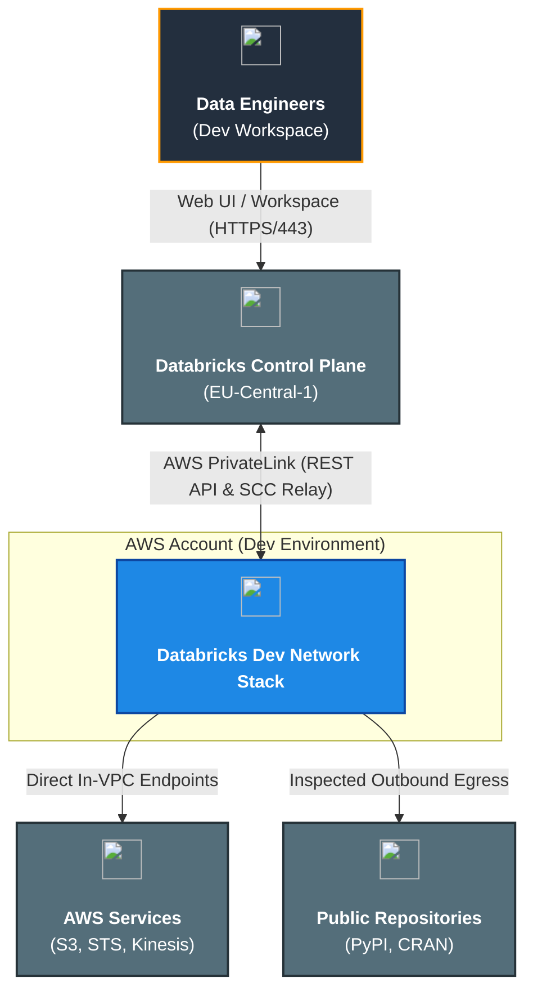

# Dev Environment: Databricks Hub-and-Spoke Networking

---

## 1. Executive Summary

- **Purpose & Scope**:
  This environment configuration orchestrates the complete development (`dev`) deployment of the **Databricks Hub-and-Spoke Network Architecture** on AWS. It provisions a dedicated Customer-Managed Spoke VPC for Databricks compute clusters, dedicated AWS PrivateLink infrastructure for Databricks Control Plane private connectivity, an Inspection & Egress Hub VPC with AWS Network Firewall, an AWS Transit Gateway interconnect, a Customer Managed KMS key, and a secured remote Terraform state backend.
- **Problem Statement & Solution**:
  Standard cloud networking architectures often allow direct outbound internet connectivity from compute clusters, introducing risks of data exfiltration and non-compliance with corporate security standards. In this `dev` environment, all outbound traffic originating from Databricks Spark clusters is forced across the AWS Transit Gateway into the Hub VPC, where stateful AWS Network Firewall rule groups enforce domain allowlists before egressing through NAT and Internet Gateways, while Control Plane communication (Workspace REST APIs and Secure Cluster Connectivity relay) is isolated onto the AWS private network via dedicated AWS PrivateLink endpoints.
- **Key Business & Security Outcomes**:
  - **No Public Cluster Footprint**: Databricks worker nodes are strictly contained within private subnets without public IP addresses.
  - **Private Control Plane Connectivity**: Dedicated PrivateLink subnets, isolated local route table, CIDR-scoped security group, and Interface VPC Endpoints (`workspace` and `scc` relay) isolate Control Plane traffic from the public internet.
  - **Stateful Domain Allowlisting**: All internet traffic is filtered against an explicit whitelist of Databricks control plane endpoints, repository mirrors (PyPI, CRAN), workspace URLs, and permitted S3 buckets (both generic and regional FQDNs).
  - **Comprehensive Egress Hardening**: Cluster and PrivateLink security groups permit traffic only across required ports (`sg_egress_ports`: 443, 3306, 6666, 2443, and 8443–8451) for Databricks operations, compliance security profiles, and extended services.
  - **Dynamic Multi-AZ Infrastructure**: Configured with dynamic availability zone discovery (`data.aws_availability_zones.available_azs`) ensuring high availability and multi-AZ resilience.
  - **Hardened State Storage**: Dedicated S3 bucket encrypted with a customer-managed KMS key and automatic 90-day non-current version lifecycle expiration.

---

## 2. General Logic & Operational Flow

### 2.1 Provisioning Lifecycle
1. **Security & State Backend**:
   The `kms_key` module provisions a CMK (`alias/vpc_networking_backend_kms_key-dev`). The `backend_bucket` module creates an encrypted, versioned S3 bucket with 90-day version lifecycle expiration for Terraform state management.
2. **Network Foundation Deployment**:
   The `spoke_vpc` module provisions the customer-managed VPC (`10.173.0.0/16`), private compute subnets (`cidrsubnet(..., 3, 0..1)`), TGW attachment subnets (`cidrsubnet(..., 3, 2..3)`), cluster security groups with Databricks egress ports (`sg_egress_ports`), and VPC endpoints (S3 Gateway, STS Interface, Kinesis Interface).
   Concurrently, the `hub_vpc` module provisions the inspection VPC (`10.10.0.0/16`), public NAT subnets, firewall subnets, and TGW attachment subnets, along with an Elastic IP and NAT Gateway.
3. **Control Plane PrivateLink Provisioning**:
   The `spoke_privatelink` module ([`003.spoke_privatelink`](file:///modules/01.networking/003.spoke_privatelink)) provisions dedicated PrivateLink VPC endpoint subnets (`cidrsubnet(..., 3, 4..5)`), an isolated local route table (`spoke-pl-vpce-rt-dev`), a dedicated security group (`spoke_pl_vpce_sg-dev`) using `local.sg_egress_ports`, and the two regional Databricks Interface VPC Endpoints (`backend_rest` and `relay`).
4. **Interconnect & Central Routing**:
   The `spoke_hub_transit_gateway` module establishes the AWS Transit Gateway, attaches both VPCs via their respective TGW subnets, and configures default route propagation so that Spoke traffic `0.0.0.0/0` directs into the Transit Gateway.
5. **Firewall Inspection & Egress Steering**:
   The `hub_vpc_network_firewall` module creates the AWS Network Firewall instance in the Hub firewall subnets and installs stateful rule groups containing Databricks FQDN allowlists (combining workspace URLs, package repositories, and dual generic/regional S3 bucket domains). Symmetric routing directs traffic between the NAT Gateway and Network Firewall endpoints.

### 2.2 Network & Traffic Flow
- **Control Plane PrivateLink Path (Databricks Worker -> Databricks Control Plane)**:
  `spoke_db_private_subnet` $\rightarrow$ Local VPC Route $\rightarrow$ `spoke_pl_vpce_sg-dev` (TCP `sg_egress_ports`) $\rightarrow$ `databricks-workspace-vpce-dev` & `databricks-scc-relay-vpce-dev` (`spoke_vpce_subnet`) $\rightarrow$ AWS PrivateLink $\rightarrow$ Databricks Control Plane.
- **Egress Path (Databricks Worker -> External SaaS / Repositories)**:
  `spoke_db_private_subnet` $\rightarrow$ Route Table (`0.0.0.0/0` to TGW) $\rightarrow$ `Transit Gateway` $\rightarrow$ `hub_tgw_private_subnet` $\rightarrow$ `hub_nat` (NAT Gateway) $\rightarrow$ `hub_vpc_network_firewall` (VPC Endpoint) $\rightarrow$ `hub-igw` (Internet Gateway) $\rightarrow$ Internet.
- **Internal AWS Services Path**:
  - S3 Storage: Routed directly via Gateway VPC Endpoint in the Spoke VPC route table.
  - STS & Kinesis: Handled directly within the Spoke VPC via Interface VPC Endpoints (`com.amazonaws.eu-central-1.sts` and `com.amazonaws.eu-central-1.kinesis-streams`).

---

## 3. Architecture of the Dev Environment

### 3.1 Network Topology & Subnet Breakdown

| VPC | Subnet Name Pattern | CIDR Calculation | Route Target / Next Hop |
|:---|:---|:---:|:---|
| **Hub VPC (`10.10.0.0/16`)** | `hub-tgw-private-dev-<az>` | `cidrsubnet("10.10.0.0/16", 3, 0)` | NAT Gateway (`hub-nat-dev`) |
| **Hub VPC (`10.10.0.0/16`)** | `hub-nat-public-dev-<az>` | `cidrsubnet("10.10.0.0/16", 3, 1)` | Network Firewall Endpoint (`vpce`) |
| **Hub VPC (`10.10.0.0/16`)** | `hub-firewall-public-dev-<az>` | `cidrsubnet("10.10.0.0/16", 3, 2)` | Internet Gateway (`hub-igw-dev`) |
| **Spoke VPC (`10.173.0.0/16`)** | `spoke-db-private-dev-<az>` | `cidrsubnet("10.173.0.0/16", 3, 0..1)` | Transit Gateway (`tgw-spoke-hub-dev`) & S3 VPCE |
| **Spoke VPC (`10.173.0.0/16`)** | `spoke-tgw-private-dev-<az>` | `cidrsubnet("10.173.0.0/16", 3, 2..3)` | Transit Gateway Attachment |
| **Spoke VPC (`10.173.0.0/16`)** | `spoke-pl-vpce-dev-<az>` | `cidrsubnet("10.173.0.0/16", 3, 4..5)` | Isolated Local VPC Route (`spoke-pl-vpce-rt-dev`) |

### 3.2 Security Groups & Rule Sets
- **`default_spoke_sg-dev`**:
  - Ingress: Self-referencing TCP/UDP across all ports for inter-cluster communication.
  - Egress: Self-referencing intra-cluster traffic; TCP egress on port 443 (HTTPS for Databricks infrastructure, cloud data sources, and library repositories), port 3306 (external Hive Metastore), port 6666 (Secure Cluster Connectivity relay / PrivateLink), port 2443 (Compliance Security Profile), and ports 8443–8451 (future extendability: Databricks internal services, extended metastore, and REST APIs).
- **`spoke_pl_vpce_sg-dev`**:
  - Ingress & Egress: Bidirectional TCP rules across `local.sg_egress_ports` (`443`, `3306`, `6666`, `2443`, `8443–8451`) restricted strictly to `local.spoke_vpce_subnets_cidr` and `local.spoke_db_private_subnets_cidr`.
- **AWS Network Firewall Rules**:
  - Stateful rule group filtering HTTP/HTTPS hostnames against Databricks control plane endpoints (`frankfurt.cloud.databricks.com`, etc.), package managers (PyPI, CRAN, PythonHosted), deployed Databricks workspace URLs (`var.databricks_workspaces_urls`), and S3 storage bucket endpoints (both generic `.s3.amazonaws.com` and regional `.s3.<region>.amazonaws.com` domains derived dynamically from `var.databricks_buckets_names`).

---

## 4. Architecture C4 Visualisation

### 4.1 Level 1: System Context Diagram

### 4.2 Level 2: Container / Network Infrastructure Diagram

```mermaid
flowchart LR
    classDef hub fill:#E8F5E9,stroke:#2E7D32,stroke-width:2px,color:#1B5E20;
    classDef spoke fill:#E3F2FD,stroke:#1565C0,stroke-width:2px,color:#0D47A1;
    classDef sec fill:#FFF3E0,stroke:#E65100,stroke-width:2px,color:#BF360C;
    classDef tgw fill:#EDE7F6,stroke:#512DA8,stroke-width:2px,color:#311B92;

    subgraph HubVPC ["Hub VPC: 10.10.0.0/16"]
        HubIGW["<img src='https://raw.githubusercontent.com/mingrammer/diagrams/master/resources/aws/network/internet-gateway.png' width='32' height='32' style='width:32px;height:32px;max-width:32px;max-height:32px;display:block;margin:0 auto;object-fit:contain;' /><br/><b>hub-igw-dev</b>"]
        HubNAT["<img src='https://raw.githubusercontent.com/mingrammer/diagrams/master/resources/aws/network/nat-gateway.png' width='32' height='32' style='width:32px;height:32px;max-width:32px;max-height:32px;display:block;margin:0 auto;object-fit:contain;' /><br/><b>hub-nat-dev</b><br/>(Public Subnet)"]
        HubFW["<img src='https://raw.githubusercontent.com/mingrammer/diagrams/master/resources/aws/security/shield.png' width='32' height='32' style='width:32px;height:32px;max-width:32px;max-height:32px;display:block;margin:0 auto;object-fit:contain;' /><br/><b>AWS Network Firewall</b>"]:::sec
        HubTGWSubnet["<img src='https://raw.githubusercontent.com/mingrammer/diagrams/master/resources/aws/network/endpoint.png' width='28' height='28' style='width:28px;height:28px;max-width:28px;max-height:28px;display:block;margin:0 auto;object-fit:contain;' /><br/><b>Hub TGW Subnet</b>"]
    end
    class HubVPC hub;

    TGW["<img src='https://raw.githubusercontent.com/mingrammer/diagrams/master/resources/aws/network/transit-gateway.png' width='36' height='36' style='width:36px;height:36px;max-width:36px;max-height:36px;display:block;margin:0 auto;object-fit:contain;' /><br/><b>Transit Gateway</b><br/>(tgw-spoke-hub-dev)"]:::tgw

    subgraph SpokeVPC ["Spoke VPC: 10.173.0.0/16"]
        SpokeTGWSubnet["<img src='https://raw.githubusercontent.com/mingrammer/diagrams/master/resources/aws/network/endpoint.png' width='28' height='28' style='width:28px;height:28px;max-width:28px;max-height:28px;display:block;margin:0 auto;object-fit:contain;' /><br/><b>Spoke TGW Subnets</b>"]
        SpokeCompute["<img src='https://raw.githubusercontent.com/mingrammer/diagrams/master/resources/aws/network/vpc.png' width='28' height='28' style='width:28px;height:28px;max-width:28px;max-height:28px;display:block;margin:0 auto;object-fit:contain;' /><br/><b>Databricks Compute Subnets</b>"]
        SpokePLSubnet["<img src='https://raw.githubusercontent.com/mingrammer/diagrams/master/resources/aws/network/privatelink.png' width='32' height='32' style='width:32px;height:32px;max-width:32px;max-height:32px;display:block;margin:0 auto;object-fit:contain;' /><br/><b>PrivateLink Subnets</b><br/>(Workspace & SCC Relay VPCEs)"]:::sec
        S3Endpoint["<img src='https://raw.githubusercontent.com/mingrammer/diagrams/master/resources/aws/storage/simple-storage-service-s3.png' width='32' height='32' style='width:32px;height:32px;max-width:32px;max-height:32px;display:block;margin:0 auto;object-fit:contain;' /><br/><b>S3 Gateway Endpoint</b>"]
        STSEndpoint["<img src='https://raw.githubusercontent.com/mingrammer/diagrams/master/resources/aws/network/endpoint.png' width='32' height='32' style='width:32px;height:32px;max-width:32px;max-height:32px;display:block;margin:0 auto;object-fit:contain;' /><br/><b>STS & Kinesis VPC Endpoints</b>"]
        SparkNodes["<img src='https://raw.githubusercontent.com/mingrammer/diagrams/master/resources/onprem/analytics/databricks.png' width='36' height='36' style='width:36px;height:36px;max-width:36px;max-height:36px;display:block;margin:0 auto;object-fit:contain;' /><br/><b>Databricks Clusters</b><br/>(Private Subnets)"]
    end
    class SpokeVPC spoke;

    SparkNodes --> SpokeCompute
    SpokeCompute --> S3Endpoint
    SpokeCompute --> STSEndpoint
    SpokeCompute -->|"Local Route (PrivateLink)"| SpokePLSubnet
    SpokeCompute -->|"0.0.0.0/0"| SpokeTGWSubnet
    SpokeTGWSubnet --> TGW
    TGW --> HubTGWSubnet
    HubTGWSubnet --> HubNAT
    HubNAT --> HubFW
    HubFW --> HubIGW
    HubIGW -->|"Egress"| Internet["<img src='https://raw.githubusercontent.com/mingrammer/diagrams/master/resources/aws/general/internet-alt1.png' width='32' height='32' style='width:32px;height:32px;max-width:32px;max-height:32px;display:block;margin:0 auto;object-fit:contain;' /><br/><b>Public Internet</b>"]
```

### 4.3 Level 3: Component Diagram (Terraform Module Orchestration)

```mermaid
graph TD
    classDef env fill:#E0F7FA,stroke:#00838F,stroke-width:2px,color:#004D40;
    classDef mod fill:#EDE7F6,stroke:#4527A0,stroke-width:1.5px,color:#311B92;

    DevConfig["<img src='https://raw.githubusercontent.com/mingrammer/diagrams/master/resources/aws/general/general.png' width='28' height='28' style='width:28px;height:28px;max-width:28px;max-height:28px;display:block;margin:0 auto;object-fit:contain;' /><br/><b>environments/dev/main.tf</b>"]:::env

    ModKMS["<img src='https://raw.githubusercontent.com/mingrammer/diagrams/master/resources/aws/security/key-management-service.png' width='28' height='28' style='width:28px;height:28px;max-width:28px;max-height:28px;display:block;margin:0 auto;object-fit:contain;' /><br/><b>module.kms_key</b><br/>(02.security/001.kms_key)"]:::mod
    ModBackend["<img src='https://raw.githubusercontent.com/mingrammer/diagrams/master/resources/aws/storage/simple-storage-service-s3.png' width='28' height='28' style='width:28px;height:28px;max-width:28px;max-height:28px;display:block;margin:0 auto;object-fit:contain;' /><br/><b>module.backend_bucket</b><br/>(03.storage/001.env_backend_bucket)"]:::mod
    ModSpoke["<img src='https://raw.githubusercontent.com/mingrammer/diagrams/master/resources/aws/network/vpc.png' width='28' height='28' style='width:28px;height:28px;max-width:28px;max-height:28px;display:block;margin:0 auto;object-fit:contain;' /><br/><b>module.spoke_vpc</b><br/>(01.networking/002.spoke_vpc)"]:::mod
    ModPL["<img src='https://raw.githubusercontent.com/mingrammer/diagrams/master/resources/aws/network/privatelink.png' width='28' height='28' style='width:28px;height:28px;max-width:28px;max-height:28px;display:block;margin:0 auto;object-fit:contain;' /><br/><b>module.spoke_privatelink</b><br/>(01.networking/003.spoke_privatelink)"]:::mod
    ModHub["<img src='https://raw.githubusercontent.com/mingrammer/diagrams/master/resources/aws/network/vpc.png' width='28' height='28' style='width:28px;height:28px;max-width:28px;max-height:28px;display:block;margin:0 auto;object-fit:contain;' /><br/><b>module.hub_vpc</b><br/>(01.networking/004.hub_vpc)"]:::mod
    ModTGW["<img src='https://raw.githubusercontent.com/mingrammer/diagrams/master/resources/aws/network/transit-gateway.png' width='28' height='28' style='width:28px;height:28px;max-width:28px;max-height:28px;display:block;margin:0 auto;object-fit:contain;' /><br/><b>module.spoke_hub_transit_gateway</b><br/>(01.networking/005.transit_gateway_spoke_hub)"]:::mod
    ModFW["<img src='https://raw.githubusercontent.com/mingrammer/diagrams/master/resources/aws/security/shield.png' width='28' height='28' style='width:28px;height:28px;max-width:28px;max-height:28px;display:block;margin:0 auto;object-fit:contain;' /><br/><b>module.hub_vpc_network_firewall</b><br/>(01.networking/006.hub_networking_firewall)"]:::mod

    DevConfig --> ModKMS
    DevConfig --> ModBackend
    DevConfig --> ModSpoke
    DevConfig --> ModPL
    DevConfig --> ModHub
    DevConfig --> ModTGW
    DevConfig --> ModFW

    ModKMS -.->|"kms_arn"| ModBackend
    ModSpoke -.->|"spoke_vpc_id"| ModPL
    ModHub -.->|"hub_vpc_id, hub_tgw_subnet_ids"| ModTGW
    ModSpoke -.->|"spoke_vpc_id, spoke_tgw_subnet_ids"| ModTGW
    ModHub -.->|"hub_vpc_id, hub_nat_public_rt_id, hub_igw_rt_id"| ModFW
```

---

## 5. All Modules Used with Short Summaries

### 5.1 Module Inventory

| Module Identifier | Source Directory | Responsibility | Key Input Dependencies |
|:---|:---|:---|:---|
| `module.kms_key` | [`../../modules/02.security/001.kms_key`](file:///modules/02.security/001.kms_key) | Provisions customer-managed KMS key for backend state and encryption. | `environment`, `kms_key_alias` |
| `module.backend_bucket` | [`../../modules/03.storage/001.env_backend_bucket`](file:///modules/03.storage/001.env_backend_bucket) | S3 state bucket with SSE-KMS, object versioning, 90-day lifecycle expiration, and public access block. | `kms_key_arn`, `bucket_name` |
| `module.spoke_vpc` | [`../../modules/01.networking/002.spoke_vpc`](file:///modules/01.networking/002.spoke_vpc) | Customer-managed Spoke VPC with private subnets, security groups, and VPC endpoints. | `spoke_cidr_block`, `availability_zones`, `sg_egress_ports` |
| `module.spoke_privatelink` | [`../../modules/01.networking/003.spoke_privatelink`](file:///modules/01.networking/003.spoke_privatelink) | Dedicated PrivateLink subnets, local route table, security group, and Interface VPC Endpoints for Databricks Control Plane. | `spoke_vpc_id`, `spoke_vpce_subnets_cidr`, `sg_egress_ports`, `workspace_vpce_service`, `relay_vpce_service` |
| `module.hub_vpc` | [`../../modules/01.networking/004.hub_vpc`](file:///modules/01.networking/004.hub_vpc) | Inspection Hub VPC with NAT Gateway, IGW, and subnets for TGW and Firewall. | `hub_cidr_block`, `availability_zones` |
| `module.spoke_hub_transit_gateway` | [`../../modules/01.networking/005.transit_gateway_spoke_hub`](file:///modules/01.networking/005.transit_gateway_spoke_hub) | Interconnects Spoke and Hub VPCs with centralized route propagation. | `hub_vpc_id`, `spoke_vpc_id`, subnet IDs |
| `module.hub_vpc_network_firewall` | [`../../modules/01.networking/006.hub_networking_firewall`](file:///modules/01.networking/006.hub_networking_firewall) | Provisions AWS Network Firewall and stateful FQDN allowlists. | `hub_vpc_id`, `region`, `whitelisted_urls`, `whitelisted_bucket_names` |

---

## 6. Terraform Documentation Interface

> [!NOTE]
> The full machine-generated Terraform interface (Providers, Modules, Inputs, Outputs, and Resource definitions) for this environment is maintained by `terraform-docs` via pre-commit hooks in [`TERRAFORM.md`](./TERRAFORM.md).

### 6.1 Essential Inputs Summary

| Variable | Type | Description | Current Dev Value |
|:---|:---:|:---|:---|
| `aws_account_id` | `string` | Allowed AWS Account ID preventing deployment to wrong account | Set via CLI or `terraform.tfvars` |
| `aws_region` | `string` | Target AWS deployment region | `"eu-central-1"` |
| `environment` | `string` | Environment name qualifier | `"dev"` |
| `profile` | `string` | AWS CLI profile name | `"default"` |
| `databricks_workspaces_urls` | `list(string)` | List of deployed Databricks workspace URLs to allow in firewall egress | `[]` |
| `databricks_buckets_names` | `list(string)` | List of deployed Databricks bucket names (root buckets, Unity Catalog metastore buckets) for S3 egress | `[]` |

For firewall S3 egress, configure `databricks_buckets_names` with all required root and Unity Catalog bucket names. The firewall module automatically derives both generic (`.s3.amazonaws.com`) and regional (`.s3.<region>.amazonaws.com`) domain targets. Do not document actual bucket-name values in this README.

### 6.2 Essential Outputs Summary

This environment does not export outputs.

---

## 7. Important Links and Resources

### 7.1 Authoritative Databricks Documentation
- [Databricks AWS E2 Firewall Hub and Spoke Architecture Guide](https://github.com/databricks/terraform-provider-databricks/blob/main/docs/guides/aws-e2-firewall-hub-and-spoke.md)
- [Databricks AWS PrivateLink Workspace Guide (Terraform)](https://registry.terraform.io/providers/databricks/databricks/latest/docs/guides/aws-private-link-workspace)
- [Databricks Classic Private Connectivity & PrivateLink](https://docs.databricks.com/aws/en/security/network/classic/privatelink)
- [Databricks on AWS Official Documentation](https://docs.databricks.com/aws/en/)
- [Databricks Customer-Managed VPC Configuration Guide](https://docs.databricks.com/aws/en/administration-guide/cloud-configurations/aws/customer-managed-vpc)

### 7.2 Authoritative AWS Documentation
- [AWS Official Documentation](https://docs.aws.amazon.com/)
- [AWS Network Firewall Developer Guide](https://docs.aws.amazon.com/network-firewall/latest/developerguide/what-is-aws-network-firewall.html)
- [AWS Transit Gateway Documentation](https://docs.aws.amazon.com/vpc/latest/tgw/what-is-transit-gateway.html)
- [AWS Well-Architected Framework](https://aws.amazon.com/architecture/well-architected/)

### 7.3 Project Documentation References
- [Project Root Documentation](file:///README.md)
- [Project Instructions & Source of Truth](file:///.ai/instructions.md)
- [Authoritative README Template](file:///.ai/README_TEMPLATE.md)
