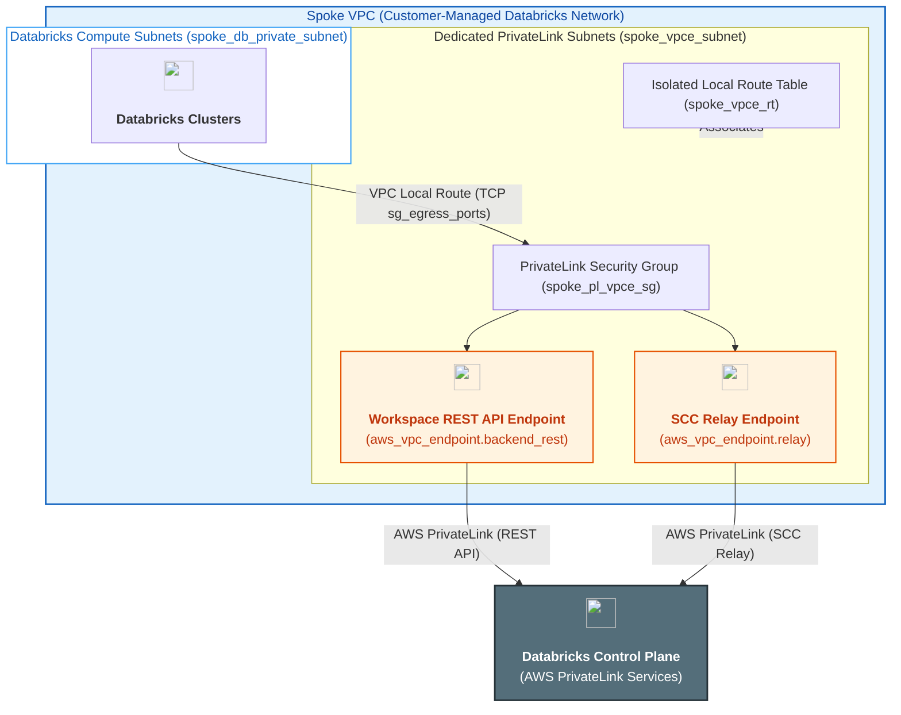
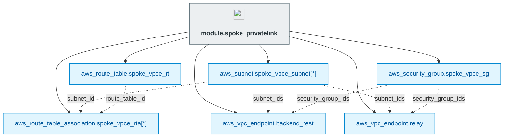

# Databricks Control Plane PrivateLink Module (`003.spoke_privatelink`)

---

## 1. Executive Summary

- **Purpose & Scope**:
  This module provisions the complete set of **AWS PrivateLink infrastructure resources** required within a customer-managed Spoke VPC to establish private back-end connectivity between Databricks classic compute clusters and the **Databricks Control Plane** (Workspace REST APIs and Secure Cluster Connectivity relay). Consistent with the project's separation of concerns, this module provisions only the underlying AWS network and security objects (subnets, isolated local route table, security group, and Interface VPC Endpoints) and exports their identifiers for downstream Databricks MWS registration.
- **Problem Statement & Solution**:
  Without AWS PrivateLink, communication between Databricks clusters in the customer-managed VPC and the Databricks Control Plane (for REST API calls and Secure Cluster Connectivity tunnel establishment) traverses public network paths or NAT/firewall gateways. This module isolates Control Plane communication onto the AWS private network backbone by deploying dedicated VPC endpoint subnets with a local-only route table, a least-privilege endpoint security group controlled via `var.sg_egress_ports`, and dedicated AWS Interface VPC Endpoints for the Databricks Workspace and SCC Relay services.
- **Key Business & Security Outcomes**:
  - **Private Control Plane Connectivity**: Eliminates public internet traversal for compute-to-control-plane traffic (REST APIs and SCC relay).
  - **Dedicated Subnet & Route Table Isolation**: Places PrivateLink interface endpoints in dedicated subnets attached to a separate route table containing only the VPC-local route, adhering to official Databricks best practices.
  - **Strict CIDR-Scoped Security Group**: Configures bidirectional TCP rules across `var.sg_egress_ports` (e.g., 443, 6666, 2443, 3306, 8443–8451) restricted exclusively to the compute private subnet CIDRs and PrivateLink endpoint subnet CIDRs.
  - **Automated Private DNS Resolution**: Enables private DNS (`private_dns_enabled = true`) on both Interface VPC Endpoints so compute clusters automatically resolve Databricks Control Plane domains to private endpoint IPs.

---

## 2. General Logic & Operational Flow

### 2.1 Configuration & Provisioning Lifecycle
1. **Dedicated PrivateLink Subnets**:
   Provisions `aws_subnet.spoke_vpce_subnet` in [`main.tf`](./main.tf) across the specified availability zones (`var.spoke_vpce_subnets_cidr`) with `map_public_ip_on_launch = false`.
2. **Isolated Local Route Table**:
   Provisions `aws_route_table.spoke_vpce_rt` without internet or Transit Gateway routes (retaining only the implicit local VPC route) and associates all PrivateLink subnets with it via `aws_route_table_association.spoke_vpce_rta`.
3. **PrivateLink Security Group**:
   Provisions `aws_security_group.spoke_vpce_sg` in [`privatelink_security_groups.tf`](./privatelink_security_groups.tf), dynamically generating inbound and outbound TCP rules for every port supplied in `var.sg_egress_ports`, restricted to `local.vpce_allowed_cidrs` (the union of `var.spoke_vpce_subnets_cidr` and `var.spoke_db_private_subnets_cidr`).
4. **Control Plane Interface VPC Endpoints**:
   Provisions two `aws_vpc_endpoint` (`Interface`) resources in [`privatelink_endpoints.tf`](./privatelink_endpoints.tf):
   - `aws_vpc_endpoint.backend_rest`: Connects to the regional Databricks Workspace REST API service (`var.workspace_vpce_service`).
   - `aws_vpc_endpoint.relay`: Connects to the regional Databricks Secure Cluster Connectivity (SCC) relay service (`var.relay_vpce_service`).

### 2.2 Network & Traffic Flow
- **Cluster-to-Control Plane REST API Traffic**:
  Databricks Spark nodes (`spoke_db_private_subnet`) $\rightarrow$ VPC local route $\rightarrow$ `spoke_pl_vpce_sg` (TCP `443` / `2443` / `sg_egress_ports`) $\rightarrow$ `aws_vpc_endpoint.backend_rest` (`spoke_vpce_subnet`) $\rightarrow$ AWS PrivateLink backbone $\rightarrow$ Databricks Control Plane REST API.
- **Secure Cluster Connectivity (SCC) Relay Tunnel**:
  Databricks Spark nodes (`spoke_db_private_subnet`) $\rightarrow$ VPC local route $\rightarrow$ `spoke_pl_vpce_sg` (TCP `6666` / `2443` / `sg_egress_ports`) $\rightarrow$ `aws_vpc_endpoint.relay` (`spoke_vpce_subnet`) $\rightarrow$ AWS PrivateLink backbone $\rightarrow$ Databricks Control Plane SCC Relay.

---

## 3. Architecture of the Module

### 3.1 Subnet & Routing Architecture

| Resource | Name Tag Pattern | Route Table | Route Target | Purpose |
|:---|:---|:---|:---|:---|
| `aws_subnet.spoke_vpce_subnet` | `spoke-pl-vpce-<env>-<az>` | `spoke-pl-vpce-rt-<env>` | Local VPC CIDR only | Dedicated private subnets hosting Databricks PrivateLink ENIs. |
| `aws_route_table.spoke_vpce_rt` | `spoke-pl-vpce-rt-<env>` | Self | Local VPC CIDR only | Isolates PrivateLink endpoint subnets from external default routes. |

### 3.2 Security Group Rules (`spoke_pl_vpce_sg`)

| Direction | Protocol | Ports | Source / Destination CIDRs | Purpose |
|:---|:---:|:---:|:---|:---|
| **Ingress** | TCP | `var.sg_egress_ports` (e.g. `443`, `3306`, `6666`, `2443`, `8443-8451`) | `spoke_vpce_subnets_cidr` + `spoke_db_private_subnets_cidr` | Allows inbound PrivateLink connections from Databricks compute nodes and endpoint subnets. |
| **Egress** | TCP | `var.sg_egress_ports` (e.g. `443`, `3306`, `6666`, `2443`, `8443-8451`) | `spoke_vpce_subnets_cidr` + `spoke_db_private_subnets_cidr` | Allows outbound PrivateLink communication to compute and endpoint subnets. |

---

## 4. Architecture C4 Visualisation

### 4.1 Level 2: Container / Network Infrastructure Diagram

### 4.2 Level 3: Component Diagram (Terraform Resources)

---

## 5. All Modules Used with Short Summaries

This module uses native `hashicorp/aws` resources directly (`aws_subnet`, `aws_route_table`, `aws_route_table_association`, `aws_security_group`, and `aws_vpc_endpoint`) and does not invoke child submodules.

---

## 6. Terraform Documentation Interface

> [!NOTE]
> Detailed inputs, outputs, provider requirements, and resource mappings are generated automatically by `terraform-docs` in [`TERRAFORM.md`](./TERRAFORM.md).

### 6.1 Essential Inputs Summary

| Variable | Type | Description | Required |
|:---|:---:|:---|:---:|
| `spoke_vpc_id` | `string` | ID of the Databricks Customer-Managed Spoke VPC | Yes |
| `spoke_db_private_subnets_cidr` | `list(string)` | CIDR blocks of the Databricks compute private subnets in the Spoke VPC | Yes |
| `spoke_vpce_subnets_cidr` | `list(string)` | CIDR blocks for the dedicated PrivateLink VPC endpoint subnets | Yes |
| `availability_zones` | `list(string)` | List of availability zones for PrivateLink VPC endpoint subnets | Yes |
| `workspace_vpce_service` | `string` | Regional Databricks PrivateLink service name for Workspace (REST API) access | Yes |
| `relay_vpce_service` | `string` | Regional Databricks PrivateLink service name for SCC relay | Yes |
| `sg_egress_ports` | `list(number)` | List of TCP ports allowed on the PrivateLink security group | Yes |
| `private_dns_enabled` | `bool` | Whether to enable private DNS on the PrivateLink endpoints (default: `true`) | No |
| `env` | `string` | Environment name suffix (e.g. `dev`) | Yes |
| `tags` | `map(string)` | Extra tags applied to PrivateLink resources | No |

### 6.2 Essential Outputs Summary

This module does not export outputs.

---

## 7. Important Links and Resources

### 7.1 Authoritative Documentation
- [Databricks AWS PrivateLink Workspace Guide (Terraform)](https://registry.terraform.io/providers/databricks/databricks/latest/docs/guides/aws-private-link-workspace) - Imperative source of truth for provisioning AWS and Databricks PrivateLink workspace resources.
- [Databricks Classic PrivateLink Documentation](https://docs.databricks.com/aws/en/security/network/classic/privatelink) - Imperative source of truth for classic compute plane PrivateLink architecture, subnets, route tables, and security groups.
- [Databricks IP Addresses and Domains (PrivateLink Services)](https://docs.databricks.com/aws/en/resources/ip-domain-region#privatelink) - Regional VPC endpoint service names for Databricks.
- [AWS Interface VPC Endpoints (AWS PrivateLink)](https://docs.aws.amazon.com/vpc/latest/privatelink/vpce-interface.html) - AWS documentation on Interface VPC Endpoints.

### 7.2 Internal References
- [Terraform Contract (`TERRAFORM.md`)](./TERRAFORM.md)
- [Spoke VPC Module (`002.spoke_vpc`)](file:///modules/01.networking/002.spoke_vpc)
- [Project Instructions & Source of Truth](file:///.ai/instructions.md)
- [Authoritative README Template](file:///.ai/README_TEMPLATE.md)
